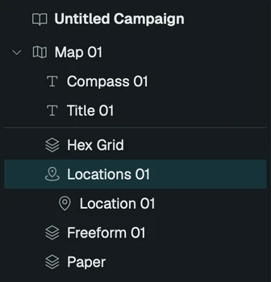
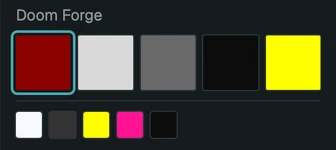
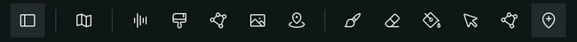

# Getting started

This guide goes from an empty window to one printed page: a hex map on A5, with a title, a compass and a key of numbered places. Every step uses the menu bar, and the menus show the shortcuts.

## A campaign and a map

Map & Territory opens on Untitled: one empty campaign. A campaign is the file you save, and it holds every map for a game. Choose **Map ▸ New Map** (Option-Cmd-N). The map arrives with two layers, a paper at the bottom and a hex grid on top, and its settings show in the inspector on the right.

The scene panel on the left lists the campaign, its maps and each map's layers. Click a row to select it and edit it in the inspector. Rename the map there. Its name becomes the map's title later.

The page itself belongs to the campaign. Select **Untitled Campaign** at the top of the scene panel: Page size is A5 and Page orientation is Portrait, which is a zine page. Page margin is the white border around everything.

## Terrain

Choose **Layer ▸ Add Freeform Layer**. Freeform is the layer you paint by hand: each hex takes the colour of one terrain.

The terrains are in the setting strip under the inspector. A new campaign uses the Doom Forge setting: Blood Mires, Bone Fields, Ash Thickets, Iron Graves and Doom Crags. Hover a swatch for its name, and click one to paint with it. To use another setting, select the campaign and pick it in the **Setting** field.

Three tools do the painting:

- **Paint** (1) colours each hex you drag across.
- **Erase** (2) clears them.
- **Fill** (3) floods the connected hexes of one kind. Fill an empty map with Bone Fields for the ground, then paint the rest over it.

Hold Space to pan while a tool is active, and use **View ▸ Fit in Window** (Cmd-0) to see the whole map again. Every stroke is one step of **Edit ▸ Undo**.

Use a second freeform layer for anything you may want to hide or move on its own, such as roads or settlements. Layers draw in the order the scene panel lists them, bottom up. **Layer ▸ Bring Forward** and **Send Backward** reorder them.

## The grid

Select **Hex Grid**. It always draws on top of the terrain.

- **Hex size** sets how coarse the map is. Pointy-top or flat-top is **Orientation**. Choose both before you paint much, since they change where every hex sits.
- **Line strength** is how solid the lines are, and **Line width** how heavy. **Hairline** draws the thinnest line the output allows: one pixel of the 300 dpi export.
- **Width noise**, **Ink noise**, **Corner jitter** and **Misregistration** make the grid look printed rather than ruled: a line that swells and thins, patchy ink, corners that wander, a grid printed out of register. Small amounts show on A5.

## Title and compass

Choose **Layer ▸ Add Title**. It prints the map's name in a ruled box in the top left, over the grid. Rename the map and the title follows. Type in its **Title** field to print something else on this map only, and add a **Subtitle** or **Credit** line under it. **Frame** picks the box: Rule, Double, or Plate for a solid block of ink.

Choose **Layer ▸ Add Compass** for a compass in the top right. **Style** picks the drawing, from a plain Mark to a Rose. **North** turns it for a map drawn at an angle.

The map's own **Face** and **Hand** (select the map) set the lettering and the line of every title and compass on it. Set Hand to Drawn or Scratched and the whole sheet looks hand-lettered.

## Places

Press **6** for **Add Location** and click a hex. A Locations layer appears with the first click, and the place gets the number 1. Select the place in the scene panel to give it a **Name** and a **Note**, the short line printed under the name. The **Description** is for the key.

The location tools share one toolbar button. **Move Location** drags a place to another hex, and **Delete Location** removes the one you click. Places number themselves from the top of the scene panel down. Turn on **Hidden** for a secret: it shows faint in the window, and the printed page leaves it out without renumbering the rest.

## Print it

Choose **File ▸ Export ▸ Map as PDF…** and save. The PDF is one A5 page: the map at the top and its key below, every place numbered with its name and description. The map's **Layout** moves the key: under the map, in two or three columns, above it, or on pages of its own.

Print at actual size (100%, not "fit to page") so the hexes and line weights come out as drawn. A4 is A5 enlarged, so set the campaign's Page size to A4 to print the same page bigger.

Save the campaign with **File ▸ Save** (Cmd-S). **Export ▸ Map as PNG…** (Shift-Cmd-E) writes the map as an image for sharing on screen.

## Further

- **File ▸ Export ▸ Campaign as PDF…** prints every map in one file. The [campaign](campaign.md)'s **Booklet** lays them out as a booklet with a [cover, pages and a back](page.md).
- [Hex Noise](hex-noise.md) fills a map from noise, as a starting landmass to paint over.
- [Outline](outline.md) draws borders and coasts along hex edges.
- Each node page lists every control with its range and default.
