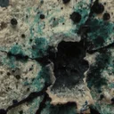
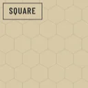
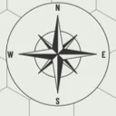
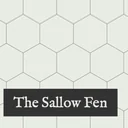
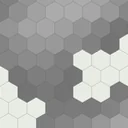
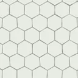
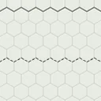
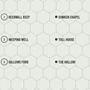
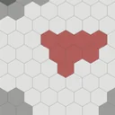
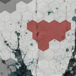

# Map & Territory nodes

<!-- generated whole by preset-docs; write in the node pages, not here -->

## Background

| | Node | What it does |
|---|---|---|
|  | [Paper](paper.md) | The sheet the map is drawn on: a flat colour at the bottom of every map. |

## Colour

- [Setting](palette.md): The world a map is drawn in: its terrains and their colours, for the maps that follow it.

## Document

| | Node | What it does |
|---|---|---|
|  | [Campaign](campaign.md) | The whole document: its maps, its settings and the notes that go with them. |
|  | [Map](map.md) | One hexmap in the campaign: a paper, a hex grid and the layers between them. |
|  | [Page](page.md) | One page of a booklet: the cover, a page between or the back, any of which may show a map. |

## Furniture

| | Node | What it does |
|---|---|---|
|  | [Compass](compass.md) | A compass that shows where north is, printed over the grid. |
|  | [Title](title.md) | The map's title in a box, with an optional subtitle and credit line, printed over the grid. |

## Generator

| | Node | What it does |
|---|---|---|
|  | [Hex Noise](hex-noise.md) | Fills hexes from smooth noise, as greys to shape a landmass or as terrain colour. |

## Grid

| | Node | What it does |
|---|---|---|
|  | [Hex Grid](hexgrid.md) | The hex grid drawn over the map, and the grid every other layer is laid out on. |

## Lines

| | Node | What it does |
|---|---|---|
|  | [Outline](outline.md) | Lines drawn along hex edges, for coasts, borders and roads. |

## Markers

| | Node | What it does |
|---|---|---|
|  | [Locations](locations.md) | Named places on the map, numbered for the key: keeps, wells, fords, lairs. |

## Object

- [Location](location.md): One named place on the map: a hex, its name and what is there.

## Painting

| | Node | What it does |
|---|---|---|
|  | [Freeform](freeform.md) | Hexes you paint by hand, each filled with a terrain from the setting. |
|  | [Image](image.md) | A picture from a file laid over the map, for stains, paper grain or a scanned drawing. |
