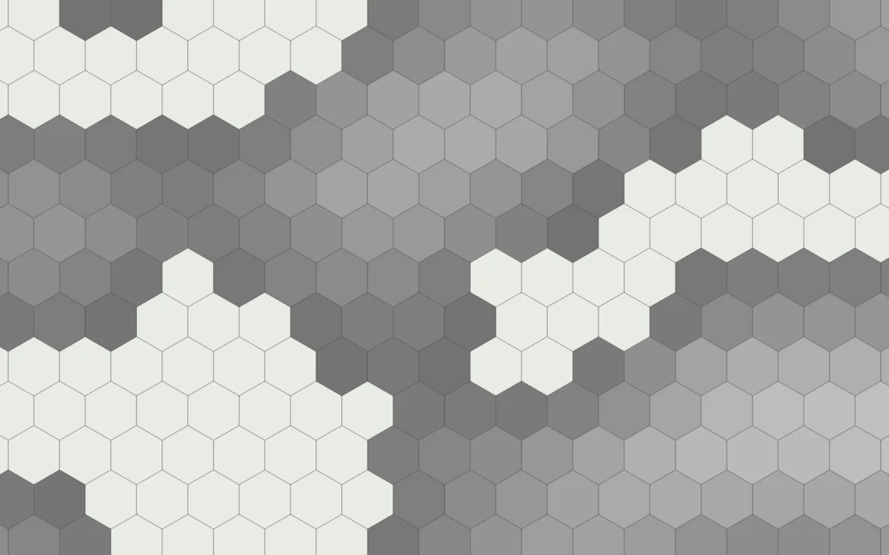
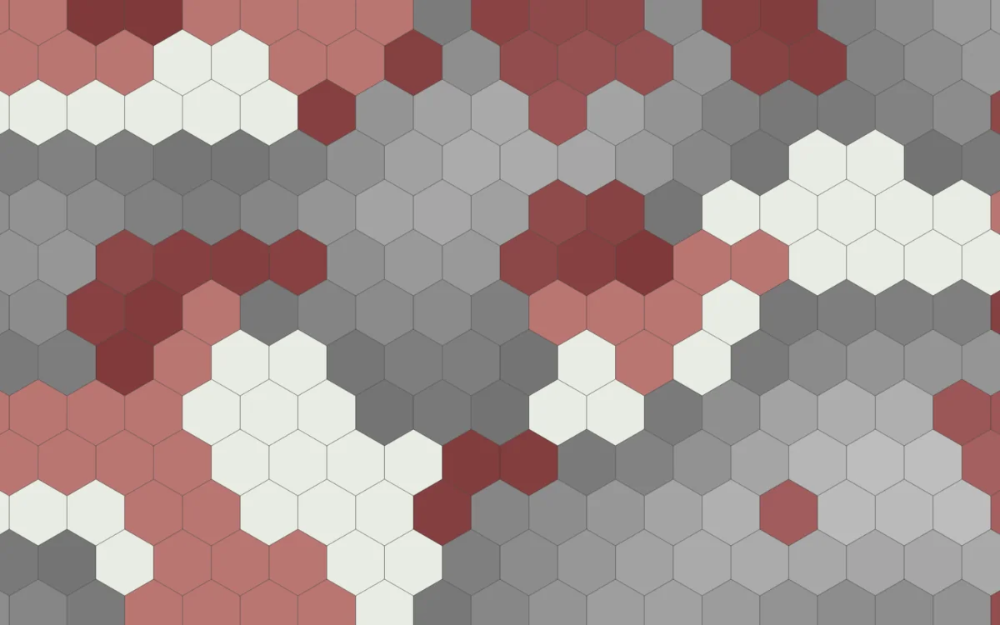

# Hex Noise

<!-- generated:begin — preset-docs rewrites this block; write outside it -->
Fills hexes from smooth noise, as greys to shape a landmass or as terrain colour.

| Control | Range | Default | What it does |
|---|---|---|---|
| Name | text | Hex Noise | What the layer is called in the layer list. |
| Visible | on or off | on | Whether the layer is drawn. |
| Opacity | 0 to 1 | 1 | How much of the layer shows through; 0 hides it, 1 draws it in full. |
| Blend | Normal (`normal`), Multiply (`multiply`), Screen (`screen`), Overlay (`overlay`), Darken (`darken`), Lighten (`lighten`) | Normal (`normal`) | How the layer mixes with the layers beneath it. |
| Seed | text | seed | The text the noise grows from; the same seed always gives the same pattern. |
| Frequency | 0.01 to 5 | 0.15 | How fast the noise changes from hex to hex; higher gives smaller, busier patches. |
| Offset X | -1000 to 1000 | 0 | Slides the noise sideways without changing its shape. |
| Offset Y | -1000 to 1000 | 0 | Slides the noise up or down without changing its shape. |
| Intensity | 0 to 1 | 1 | How bright the grey is in shape mode; 0 is black. |
| Gamma | 0.1 to 5 | 1 | Bends the noise towards its low or high end; 1 leaves it as it is. |
| Minimum | 0 to 1 | 0 | Hexes whose noise is below this are left empty. |
| Maximum | 0 to 1 | 1 | Hexes whose noise is above this are left empty. |
| Mode | Shape (`shape`), Paint (`paint`) | Shape (`shape`) | Shape fills hexes with grey for use as a mask; paint fills them with terrain colour. |
| Terrain | text | empty | The setting's terrain painted in paint mode; empty paints its first. |
<!-- generated:end -->

## Using it

Hex Noise fills hexes from smooth random noise. On a zine page it is the quick way to rough out a landmass, a forest or a stretch of hills, which you then work over with the Freeform tools. Layer ▸ Add Hex Noise Layer adds one to the active map.

Seed is the text the noise grows from. The same Seed always gives the same pattern, so change the text until the shape looks right. Frequency sets the size of the patches: a low value gives a few broad masses, a high one a scatter of small ones. Offset X and Offset Y slide the pattern across the map without changing its shape, which moves a good coastline to where you want it. Minimum and Maximum cut the noise off: hexes with a value below Minimum or above Maximum are left empty. Gamma bends the values before the cut; above 1 it pushes them down, so fewer hexes clear a given Minimum.

Mode picks what the hexes are filled with. In Shape mode each is a grey from black to white by its noise value, and Intensity dims it; 0 is black. In Paint mode each takes the colour of a terrain from the setting. Select the layer and click a terrain in the strip under the inspector to pick it; until you do, it paints the setting's first terrain. Paint mode follows the setting: choose a different Setting for the campaign or the map and the layer repaints in the new colours. Shape mode uses no setting, and Hex Noise has no Face or Hand to follow.

Tip: for an island, raise Minimum so only the high ground is filled and the rest stays empty.

## Recipes

**Clean map.** Mode Paint, Frequency 0.08, Minimum 0.45, Maximum 1, Opacity 1. A few broad islands, each edge on whole hexes, in the terrain colour you picked. Change Seed until the coast suits the page.

**Grimdark map.** Mode Paint, Frequency 0.3, Minimum 0.35, Maximum 0.8, Opacity 0.6, Blend Multiply, with a dark terrain such as Blood Mires from Doom Forge. The patches are small, and the hexes where the noise runs high are left empty, so the ground looks pitted. Multiply darkens whatever lies beneath instead of covering it.

## Examples

<!-- examples:begin — `just examples` rewrites this block; write outside it -->

*Mode set to Shape, Frequency 0.15 and Minimum 0.45: a grey landmass.*

*A second layer with Seed forest, Frequency 0.25, Minimum 0.55, Mode Paint, Terrain Blood Mires and Opacity 0.5, over the shape layer.*
<!-- examples:end -->
