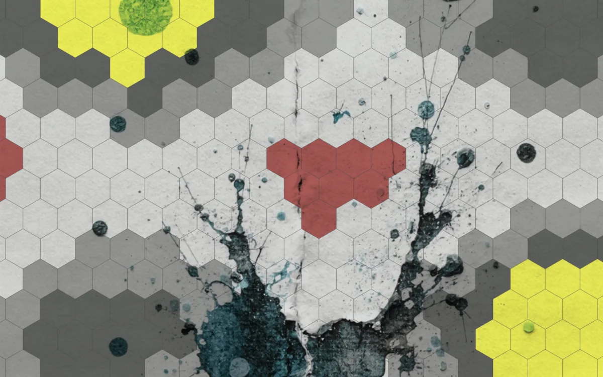

# Image

<!-- generated:begin — preset-docs rewrites this block; write outside it -->
A picture from a file laid over the map, for stains, paper grain or a scanned drawing.

| Control | Range | Default | What it does |
|---|---|---|---|
| Name | text | Image | What the layer is called in the layer list. |
| Visible | on or off | on | Whether the layer is drawn. |
| Opacity | 0 to 1 | 1 | How much of the layer shows through; 0 hides it, 1 draws it in full. |
| Blend | Normal (`normal`), Multiply (`multiply`), Screen (`screen`), Overlay (`overlay`), Darken (`darken`), Lighten (`lighten`) | Normal (`normal`) | How the layer mixes with the layers beneath it. |
| Fit | Cover (`cover`), Fit (`contain`), Repeat (`repeat`) | Cover (`cover`) | Cover fills the paper and crops the edges, fit shows the whole picture, repeat tiles it. |
| Scale | 0.05 to 8 | 1 | How large the picture is drawn; 1 is its fitted size. |
| Offset X | -1000 to 1000 | 0 | Slides the picture sideways. |
| Offset Y | -1000 to 1000 | 0 | Slides the picture up or down. |
| Rotation | -180° to 180° | 0° | Turns the picture about the middle of the paper. |

References: `file`.
<!-- generated:end -->

## Using it

On a zine page an Image is for what you made outside the app: a scan of stained paper, a photographed texture, an inked drawing that sits under the hexes. Layer ▸ Add Image Layer adds an empty layer directly below the hex grid, and nothing goes above the grid, so it stays clean on top.

Choose the picture in the Image field. Fit, Scale, Offset X, Offset Y and Rotation stay greyed out until you have. The campaign keeps the picture's path, not the picture, so the file has to stay where it is: keep it beside the campaign and use a relative path, or give the full path. A campaign that has not been saved takes only a full path. PNG, JPEG and WebP work, up to 16 MB and 4096 pixels on a side. If the file goes missing the layer draws nothing.

Fit sets how the picture meets the paper. Cover fills it and crops the edges, Fit keeps the whole picture inside, and Repeat tiles it, each tile at the picture's own size times Scale. Scale 1 is the fitted size. Offset X and Offset Y slide the picture in paper pixels, and Rotation turns it about the middle of the paper. The picture is clipped to the paper.

Blend decides how it meets what lies beneath. Multiply keeps the light parts of a scan from covering anything and lets its dark ink darken the terrain and the paper colour. An Image takes nothing from the map: not the setting, not Face or Hand, not the paper's colour.

## Recipes

**Clean map.** Usually none. For a faint grain, use a paper scan with Fit Cover, Blend Multiply and Opacity 0.15.

**Grimdark map.** Use a scan of ink splatter with Fit Cover, Blend Multiply and Opacity 0.8, as in the example. Add a second Image layer with a soot or grime scan at Fit Repeat, Scale 0.5, Opacity 0.6, Blend Multiply, and Rotation 20 so the tiles do not line up with the page.

## Examples

<!-- examples:begin — `just examples` rewrites this block; write outside it -->

*An Image of an ink-splat scan with Blend set to Multiply, over painted terrain: the ink stains the map.*
<!-- examples:end -->
