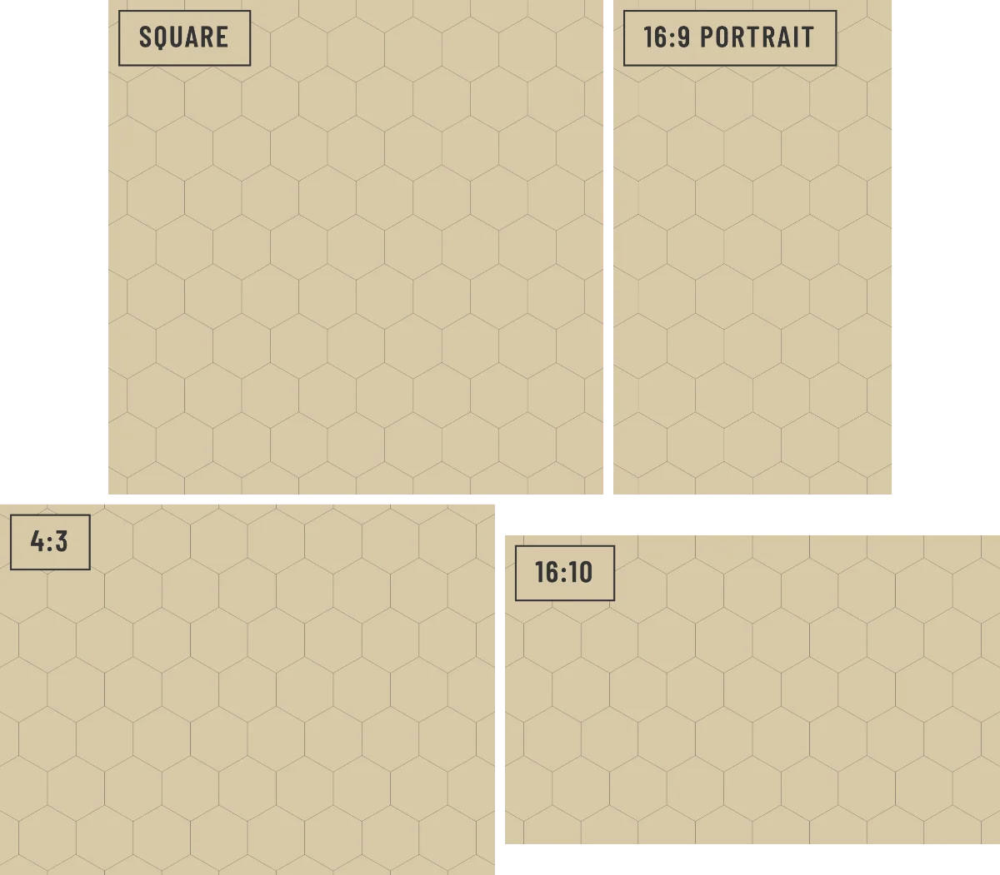

# Map

<!-- generated:begin — preset-docs rewrites this block; write outside it -->
One hexmap in the campaign: a paper, a hex grid and the layers between them.

| Control | Range | Default | What it does |
|---|---|---|---|
| Name | text | empty | What you call the map. |
| Description | text | empty | Notes about this map, such as the region it covers. |
| Layout | Map on top, key below (`map-top`), Map on top, key in two columns (`map-top-2col`), Map on top, key in three columns (`map-top-3col`), Key on top, map below (`map-bottom`), Map alone, key on its own pages (`map-full`) | Map on top, key below (`map-top`) | Where the map sits on its page and where its key goes. The map keeps its shape; a long key runs on to more pages. |
| Visible | on or off | on | Whether the map is shown. |
| Face | Condensed (`condensed`), Serif (`serif`), Blackletter (`blackletter`), Marker (`marker`) | Condensed (`condensed`) | The lettering of every title left on Map: a condensed sans in capitals, an old atlas serif, blackletter, or a marker in capitals. |
| Hand | Clean (`clean`), Drawn (`drawn`), Scratched (`scratched`) | Clean (`clean`) | How every title left on Map is drawn: ruled, pen-drawn, or scratched in and gone over twice. |

References: `palette`.
<!-- generated:end -->

## Using it

A map is one sheet of the campaign: a region, a dungeon level, a town. On a zine page it is the picture the reader turns to: one map is printed on one page, with its key of numbered places. Each map holds a paper at the bottom, a hex grid on top, and any layers you add between them. Map ▸ New Map adds one.

Give maps plain names so the list reads like your session notes. A Title layer whose Title is blank prints the map's name, and a map with no name prints "Untitled map" in a faded ink. If a map should look different from the rest, select it and choose a different Setting; the first entry, Campaign's, follows the campaign again.

Layout puts the map on its page and the key where you choose: below the map, below it in two or three columns, above it, or with the map alone and the key on pages of its own. The map keeps its shape, and the page's size, orientation and margin come from the campaign. A long key runs on to more pages.

Face and Hand are the map's sheet style: every title and compass on the map left on Map letters itself in the map's face and is drawn in its hand, so one change restyles the whole sheet. A locations layer follows the map's Face but has no Hand. Layers such as Outline, Hex Grid and Image have neither, and keep the look you gave them.

## Recipes

**Clean map.** Face Condensed, Hand Clean, Layout Map on top, key below. Leave the Setting on Campaign's, with a muted setting such as Brittle Empire on the campaign.

**Grimdark map.** Setting Doom Forge, Face Blackletter, Hand Scratched, Layout Map on top, key in two columns. The titles and the compass letter themselves in blackletter and are scratched in; the key keeps the map to the top of the page and spreads its entries across two columns.

## Examples

<!-- examples:begin — `just examples` rewrites this block; write outside it -->

*Aspect set to Square, 16:9, 4:3 and 16:10, the 16:9 with Orientation Portrait.*
<!-- examples:end -->
