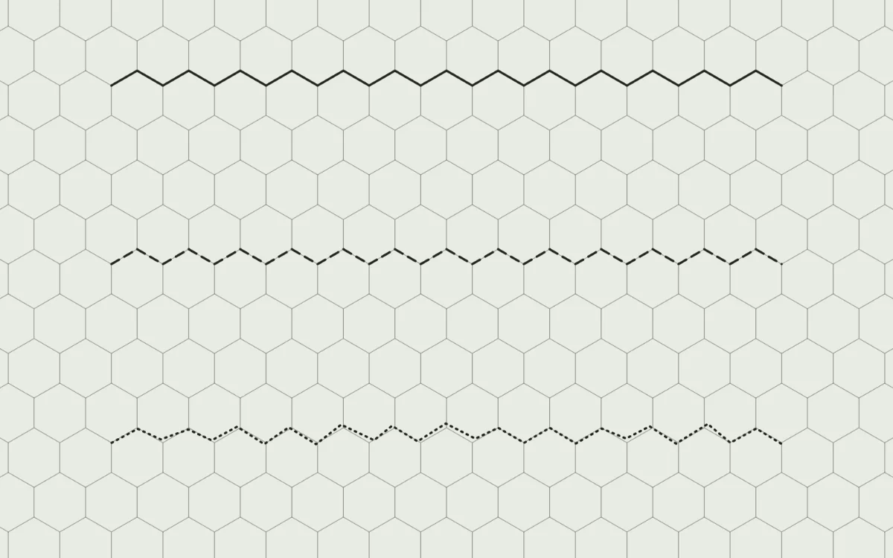

# Outline

<!-- generated:begin — preset-docs rewrites this block; write outside it -->
Lines drawn along hex edges, for coasts, borders and roads.

| Control | Range | Default | What it does |
|---|---|---|---|
| Name | text | Outline | What the layer is called in the layer list. |
| Visible | on or off | on | Whether the layer is drawn. |
| Opacity | 0 to 1 | 1 | How much of the layer shows through; 0 hides it, 1 draws it in full. |
| Blend | Normal (`normal`), Multiply (`multiply`), Screen (`screen`), Overlay (`overlay`), Darken (`darken`), Lighten (`lighten`) | Normal (`normal`) | How the layer mixes with the layers beneath it. |
| Paths | structured | empty | The lines drawn, each a run of hex corners, open or closed. |
| Stroke colour | colour | #f8f5e5 | The colour of every line on the layer. |
| Stroke width | 1 px to 12 px | 4 px | How thick the lines are. |
| Stroke pattern | Solid (`solid`), Dashed (`dashed`), Dotted (`dotted`) | Solid (`solid`) | Whether the lines are unbroken, dashed or dotted. |
| Roughness | 0 to 1 | 0 | How far the corners wander off the grid, for a hand-drawn line; 0 is exact. |
<!-- generated:end -->

## Using it

Outline draws lines along the edges of the hexes, following the grid. On a zine page it carries the lines that are not terrain: a coast, a border, a river, a road.

Layer ▸ Add Outline Layer adds a layer, and the Outline tool (key 5) draws on it. Click a hex corner to start a line, then click further corners to extend it along the grid. Click the first corner again to close the line into a loop, or click the last corner again to end it; the following click starts a new line. Each click is one step in Edit ▸ Undo, so Undo takes a corner back.

Stroke colour, Stroke width and Stroke pattern apply to every line on the layer, so keep roads and borders on separate Outline layers if they should look different. Stroke colour starts as a pale cream that disappears on white paper; set a dark ink before you draw. Stroke width runs from 1 to 12 px. Dashed and Dotted use marks of a fixed length, whatever the width.

Roughness moves each corner off the grid by up to a fifth of a hex at 1, in a direction fixed by the corner, so the line keeps its shape every time it draws. The line stays a run of straight segments between the moved corners. Outline keeps its own colour and roughness: changing the setting, or the map's Face and Hand, leaves it as it is.

## Recipes

**Clean map.** Stroke colour #1a1a1a, Stroke width 2, Stroke pattern Solid, Roughness 0. Put borders on a second layer with Stroke pattern Dashed, so the coast and the border can be hidden separately.

**Grimdark map.** Stroke colour #2a1a15, Stroke width 4, Roughness 0.8, which moves a corner by up to about 4 px at the default Hex size of 24. Add a second layer for tracks and rivers with Stroke pattern Dotted, Stroke width 3, Roughness 1.

## Examples

<!-- examples:begin — `just examples` rewrites this block; write outside it -->

*Three layers with Stroke pattern Solid, Dashed and Dotted, Stroke width 3; the Dotted one also at Roughness 1.*
<!-- examples:end -->
