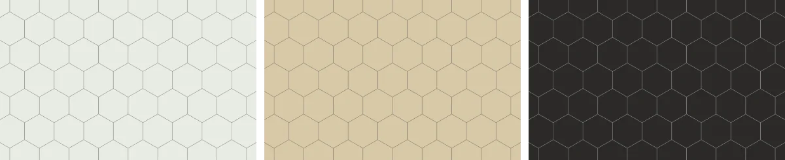
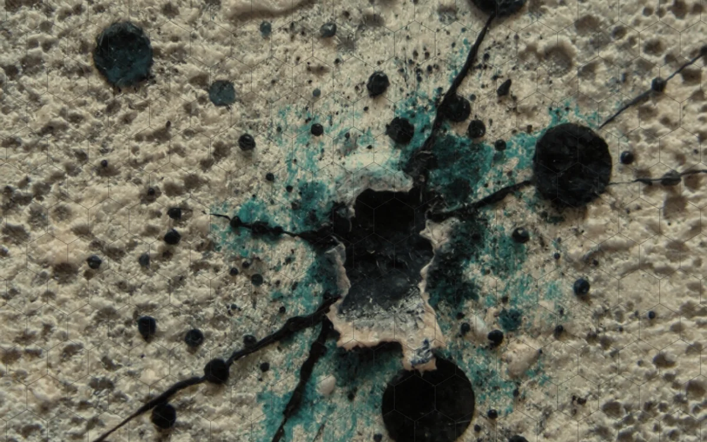

# Paper

<!-- generated:begin — preset-docs rewrites this block; write outside it -->
The sheet the map is drawn on: a flat colour at the bottom of every map.

| Control | Range | Default | What it does |
|---|---|---|---|
| Aspect | Square (`square`), 4:3 (`4:3`), 16:10 (`16:10`), 16:9 (`16:9`) | 16:10 (`16:10`) | The shape of the sheet, as width to height. |
| Orientation | Landscape (`landscape`), Portrait (`portrait`) | Landscape (`landscape`) | Lying down, wider than tall, or standing up, taller than wide. A square has none. |
| Colour | colour | #ffffff | The colour of the paper. |
| Mix with paper | Image only (`normal`), Multiply (`multiply`) | Multiply (`multiply`) | How the image mixes with the paper colour: image only, or multiplied over the colour so the paper shows through its light parts. |
| Texture fit | Cover (`cover`), Fit (`contain`), Repeat (`repeat`) | Cover (`cover`) | Cover fills the sheet and crops the edges, fit keeps the whole image inside, repeat tiles it. |
| Texture scale | 0.05 to 8 | 1 | How large the image is drawn; 1 is its fitted size. Repeat tiles it at its own size times this. |

References: `texture`.
<!-- generated:end -->

## Using it

Paper is the bottom layer of every map. It's one flat colour that fills the sheet, so it sets the base tone everything else is drawn over. There is always exactly one, and it can't be deleted or duplicated.

Pick a colour that suits the look you want, such as an off-white for a parchment feel. Aspect sets the shape of the sheet: square, 4:3, 16:10 or 16:9, and Orientation lays it down or stands it up, except for a square, which has no way up. The sheet is always 1200 pixels on its long side, whatever the window, so a larger window shows the same map larger rather than more of it.

An image can go over the colour: choose a Texture, such as a scan of old paper. Mix with paper says how it sits on the colour. Multiply lets the colour show through the light parts of the image, so a white scan takes on the paper colour. Image only shows the image as it is. Texture fit sets how it fills the sheet: cover fills it and crops the edges, fit keeps the whole image inside, and repeat tiles it. Texture scale makes the image larger or smaller. The campaign stores the image's path, not the image, so keep the file where it is. If the file goes missing, the paper shows only its colour until it comes back.

## Recipes

On a zine page the paper is the sheet under the whole map. The shape of the sheet is the shape of the map on the printed page, which keeps its proportions inside the campaign's margins.

**Clean map.** Colour #ffffff, no Texture, Aspect 4:3, Orientation Portrait for a map taller than it is wide. Nothing but flat white under the terrain.

**Grimdark map.** Colour #d9cdb0, a scan of old paper as the Texture, Mix with paper Multiply, Texture fit Cover, Texture scale 1. The paper colour shows through the light parts of the scan and the dark flecks stay dark.

**What follows the map.** The Paper's Colour is its own, so changing the setting leaves it alone. Other things take it from the paper: the backing of a Title and a Compass, and the paper-coloured outline, glow or label behind location names.

## Examples

<!-- examples:begin — `just examples` rewrites this block; write outside it -->

*Colour set to #e9ece4, #d8c9a8 and #2b2a28.*

*Colour #d8c9a8 with a Texture of a lace-and-grime scan, Mix with paper Multiply and Texture fit Cover.*
<!-- examples:end -->
