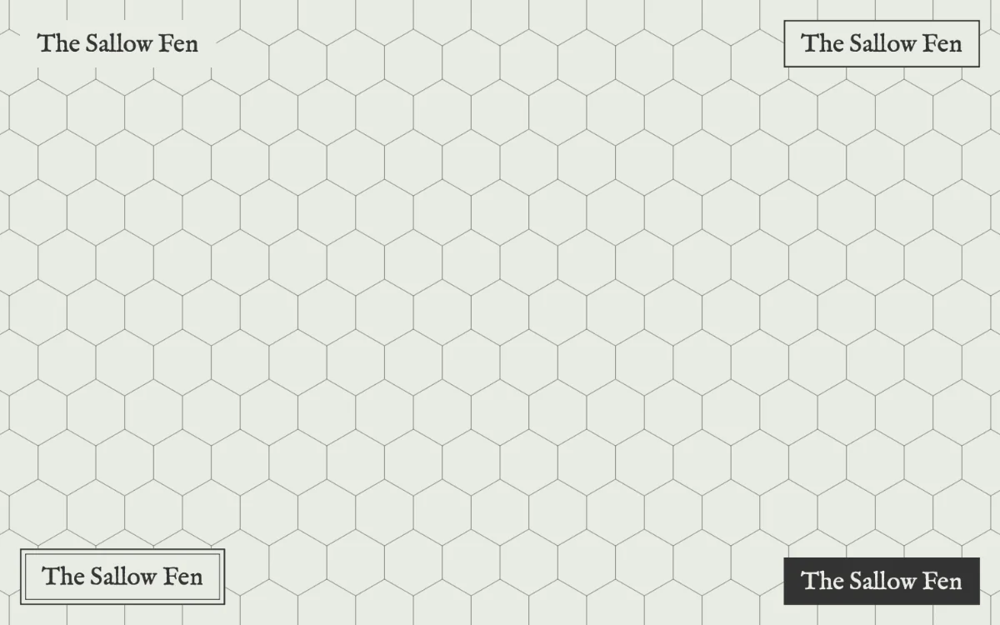
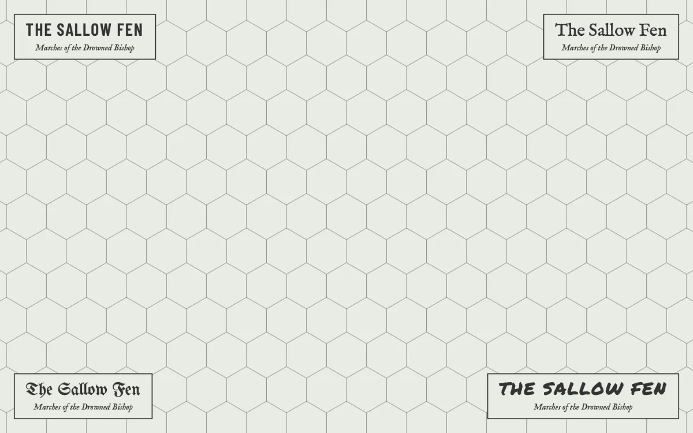

# Title

<!-- generated:begin — preset-docs rewrites this block; write outside it -->
The map's title in a box, with an optional subtitle and credit line, printed over the grid.

| Control | Range | Default | What it does |
|---|---|---|---|
| Name | text | Title | What it is called in the scene list. |
| Visible | on or off | on | Whether the layer is drawn. |
| Opacity | 0 to 1 | 1 | How much of the layer shows through; 0 hides it, 1 draws it in full. |
| Blend | Normal (`normal`), Multiply (`multiply`), Screen (`screen`), Overlay (`overlay`), Darken (`darken`), Lighten (`lighten`) | Normal (`normal`) | How the layer mixes with the layers beneath it. |
| Title | text | empty | The words printed as the title. Blank prints the map's name, so renaming the map changes it. |
| Subtitle | text | empty | A second line under the title, in an italic serif at half its size. Blank leaves it out. |
| Credit | text | empty | A small third line in a typewriter face, such as who surveyed the map and when. Blank leaves it out. |
| Frame | None (`none`), Rule (`rule`), Double (`double`), Plate (`plate`) | Rule (`rule`) | What is drawn around the lines: nothing, a ruled box, a double rule, or a solid plate with the lines reversed out of it. |
| Align | Left (`left`), Centre (`centre`), Right (`right`) | Centre (`centre`) | Where the lines sit within the box. |
| Title size | 12 px to 120 px, or more | 30 px | How tall the title is. The subtitle is half of it and the credit a third. |
| Anchor | Top left (`top-left`), Top centre (`top-centre`), Top right (`top-right`), Bottom left (`bottom-left`), Bottom centre (`bottom-centre`), Bottom right (`bottom-right`) | Top left (`top-left`) | Which corner or edge of the paper the title sits at. |
| Inset | 0 px to 200 px | 24 px | How far the title sits in from the paper's edges. |
| Backing | on or off | on | A plain plate in the paper's colour behind the title, so busy terrain doesn't show through it. |
| Face | Map (`map`), Condensed (`condensed`), Serif (`serif`), Blackletter (`blackletter`), Marker (`marker`) | Map (`map`) | The lettering of the title. Map follows the map's face. |
| Hand | Map (`map`), Clean (`clean`), Drawn (`drawn`), Scratched (`scratched`) | Map (`map`) | How the frame is drawn and the lines lean. Map follows the map's hand. |
<!-- generated:end -->

## Using it

Layer ▸ Add Title puts a title on the active map. It prints the map's name in a ruled box at the top left, over the grid, so no grid line runs through it; rename the map and the title follows. Type a Title to print something else on this map only (the map keeps its name), and clear it to bring the name back. A map with no name prints "Untitled map" in a faded ink until you name it.

Titles list above the layers in the scene panel, and they always draw on top of the grid: the layer moves don't take them below it. The title, the rule and the lines print in the grid's ink, and the backing plate in the paper's colour. Condensed and Marker set the title in capitals.

Double draws a second, finer rule inside the first: the survey-office look. Plate fills the box with solid ink and prints the lines in the paper's colour, so the title reads like a zine cover.

Face and Hand start on Map, so every title follows the map's own Face and Hand: change the map to Scratched and every title left on Map is scratched in with it. Pick a face or hand on a title to keep it as it is. Drawn redraws the frame as if with a pen and leans each line a little; Scratched wobbles it more, goes over every line twice and leans the lines further. Each title wobbles its own way, the same way every time it draws and exports, and a duplicated title wobbles differently. The backing stays clean.

## Recipes

On a zine page the title names the map for the reader: the region, a level, a town. Subtitle and Credit add a second and third line when the page wants a place name and a surveyor.

**Clean map.** Frame Rule, Align Centre, Title size 30, Anchor Top left, Inset 24, Backing on. Leave Face and Hand on Map, with the map's Face set to Condensed and Hand to Clean. Put the region in Subtitle and a date or a name in Credit.

**Grimdark map.** Frame Plate, Align Left, Title size 44, Anchor Bottom left, Backing on. Set the map's Face to Blackletter and Hand to Scratched. The plate fills with the grid's ink and the words reverse out of it in the paper's colour, scratched in with the frame.

**What follows the map.** With Title blank the title prints the map's name, so renaming the map renames the title. Face and Hand follow the map's while they stay on Map. The ink is the grid's, and the plate or backing is the Paper layer's Colour.

## Examples

<!-- examples:begin — `just examples` rewrites this block; write outside it -->

*Frame set to None, Rule, Double and Plate.*

*Face set to Condensed, Serif, Blackletter and Marker, with a Subtitle.*
<!-- examples:end -->
